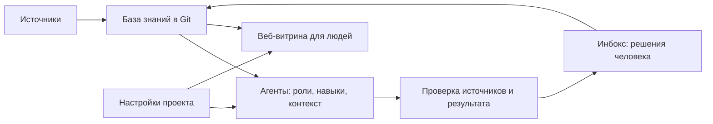
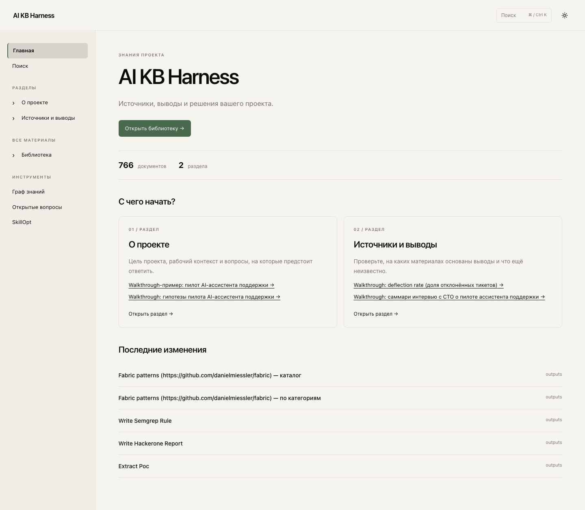

# AI KB Harness Template · 0.8.0

**Основа проекта, в котором люди и AI-агенты работают с общей базой знаний.** Собирайте источники, сохраняйте выводы и решения, продолжайте работу в другом агенте и показывайте результаты коллегам через веб-витрину.

Шаблон подходит для исследований, продуктовой работы, консалтинга и внутренней документации. Данные остаются обычными Markdown-файлами в Git. Поиск и проверки работают локально; для генерации текста вы выбираете агента или провайдера модели.

[Последнее обновление](#последнее-обновление--080) · [Начать проект](#начать-проект) · [Подключить агента](#подключить-агента) · [Рабочая система](docs/work-system.md) · [Исследования](docs/research.md) · [Витрина](#витрина-для-людей) · [Обновление](#обновлять-уже-созданные-проекты) · [Архитектура](docs/architecture.md)

## Последнее обновление — 0.8.0

22 октября 2026 · Документы и устройство витрины обновлены по практике MPLC. Читатель открывает действующую редакцию, видит части комплекта, скачивает Markdown и PDF. Сборка обнаруживает устаревший экспорт.

- **Документы:** каталог, категории, фильтры в URL, части и архив редакций.
- **Канвас:** схемы с поиском, перемещением, масштабом, выбором связей, источниками и таблицей.
- **Печать:** исходный Markdown, системная печать и сохранённый PDF; автономный HTML A4 и паспорт редакции.
- **Методы и исследования:** карточки методологий с первоисточником и лицензией, темы с результатами и исключёнными рабочими папками.
- **Организация работы:** общая дизайн-система, проверка текста отдельным критиком, продолжение с сохранённого результата и явный порядок доставки.

Откройте учебный комплект:

```bash
pnpm run setup
pnpm viewer:dev
```

На странице `/documents` выберите «Учебная записка: как проверить источник». Проверьте скачивание Markdown, PDF, приложение и прежние версии. Примеры синтетические; `kb:init --strip-demo` удаляет их неизменённые файлы.

[Переход на 0.8.0](docs/releases/0.8.0.md) · [Документы и PDF](docs/documents.md) · [Методологии](docs/methods.md) · [Дизайн-система](docs/design-system.md) · [История изменений](CHANGELOG.md).

В разделе «Схемы» откройте учебный канвас. В «Методологиях» семь стартовых карточек ведут к закреплённым канонам. Подробнее — [работа с канвасом](docs/maps.md).

## Что вы получаете

- **Понятную витрину:** разделы по темам, краткая суть, поиск документов, оглавление и раскрываемые источники.
- **Общие правила агентов:** факты отделены от предположений, выводы имеют источники, незавершённая работа передаётся следующей сессии.
- **Работу по ролям и этапам:** контекст под задачу, сохранённые промежуточные результаты, независимое ревью и накопление подтверждённого опыта.
- **Навыки под проект:** эталон, статус и версия, реестр потребителей, сравнение версий на одинаковых примерах перед применением.
- **Решения с подписью человека:** статус «принято» ставится командой человека и слетает при правке; всё ожидающее решения собрано в инбоксе.
- **Локальный поиск:** смысл, точные термины, связи между документами и даты.
- **Проверки качества:** ссылки, метаданные, происхождение выводов, свежесть знаний, дрейф документации, инварианты оснастки и воспроизводимые тесты.
- **Обновляемую оснастку:** новые выпуски шаблона переносятся в проекты с сохранением их контента и настроек.



## Начать проект

Нужны **Node.js 22**, **pnpm 9** и Git. В репозитории есть `.nvmrc`; `corepack enable` включает pnpm.

1. Нажмите **Use this template → Create a new repository** на GitHub и клонируйте созданный проект.
2. В каталоге проекта выполните:

```bash
pnpm run setup
pnpm kb:init --name "Исследование продукта" --purpose "Собрать доказательства и выбрать следующий шаг" --strip-demo --yes
pnpm harness:setup --client codex
```

3. Добавьте исходный документ в `01_raw/`, а его краткое саммари — в `02_sources/`. Пример структуры есть в [examples/human-kb](examples/human-kb/README.md).
4. Постройте индекс и проверьте базу:

```bash
pnpm kb:index
pnpm kb:search "главный вопрос исследования"
pnpm kb:doctor
pnpm check
```

5. Откройте витрину:

```bash
pnpm viewer:dev
```

Адрес: [localhost:5173](http://localhost:5173). Новому проекту можно задать название, описание и разделы без изменения компонентов.

Первое индексирование скачивает модель эмбеддингов; затем поиск работает локально. Генерация текста через настроенный внешний провайдер отправляет ему выбранный контекст. По умолчанию автоматические LLM-вызовы выключены.

`--strip-demo` удаляет только известные неизменённые демонстрационные файлы. Дописанные вами материалы сохраняются. Изолированные примеры в `examples/` не попадают в основной поисковый индекс. После инициализации сохраните `.harness/lock.json` в Git вместе с проектом.

## Подключить агента

Правила хранятся в одном каноне: [AGENTS.md](AGENTS.md) → [harness/rules](harness/rules/). Процедуры оформлены как переносимые `SKILL.md`. У каждого клиента свой способ загрузки этого канона.

| Среда | Подключение | Что учитывать |
|---|---|---|
| Codex с GPT | `pnpm harness:setup --client codex` | Общий AGENTS, навыки и пример MCP-конфигурации |
| Claude Code | `pnpm harness:setup --client claude` | CLAUDE.md импортирует AGENTS; доступны MCP и хуки |
| OpenCode, в том числе с GLM | `pnpm harness:setup --client opencode` | Модель выбирается в клиенте |
| Gemini CLI | `pnpm harness:setup --client gemini` | Собственный файл входа и MCP-адаптер |
| Другой MCP-клиент | `pnpm harness:setup --client mcp` | Явно загрузите правила и подключите сервер |

Можно выбрать несколько клиентов. Сохраните `.harness/clients.json` и созданные файлы клиента в Git вместе с проектом. Setup сохраняет чужие настройки и сообщает о конфликтующих изменениях; навыки со статусом `deprecated` клиентам не копируются. Git hooks включаются отдельно флагом `--hooks`. Проверка без исправлений: `pnpm harness:check`.

**Проверенная конфигурация не равна проверенному живому сеансу модели.** В [матрице совместимости](docs/compatibility.md) отмечено, какие проверки выполнены. Общие правила и инструменты доступны разным клиентам; качество ответов зависит и от модели.

MCP-сервер предоставляет `kb_search`, `kb_think`, `kb_backlinks`, `kb_verify`, `kb_retain`, `kb_promote`. Подробности — [semantic/README](scripts/semantic/README.md). Протокол и CLI доступны независимо от веб-витрины.

## Витрина для людей

Главная отвечает на вопросы «что это за проект» и «с чего начать». Разделы объединяют документы по теме, библиотека сохраняет доступ ко всему выбранному корпусу. Документ показывает статус, дату, владельца, содержание и связанные источники.



Порядок чтения: **суть → объяснение → доказательства**. Правила и примеры: [человеческий интерфейс](docs/human-interface.md), [разметка документов](docs/markdown-dialect.md). Действия, требующие человека, выполняются командами, а витрина показывает статусы: кнопок подтверждения без рантайма нет.

Настройка проекта:

| Файл | Что менять |
|---|---|
| `00_context/project.json` | Название, описание, статус и уровень подключения; создаётся `kb:init` |
| `00_context/work-system.json` | Необязательный профиль ролей, сценариев и процедур; создаётся `kb:profile` после подтверждения |
| `00_context/research-policy.json` | Необязательная политика моделей и лимитов для `kb:research` |
| `00_context/spaces.json` | Темы и стартовые документы |
| `kb.config.mjs` | Слои, правила проверки, подпись решений (`approval`), свежесть (`doctor`), заморозки инвариантов (`invariants`), параметры LLM и витрины |
| `.remember/core.md` | Устойчивый контекст проекта |
| `.remember/preferences.md` | Предпочтения формы ответа |
| `skills/` | Ваши дополнительные навыки |

`audience: [research]` относит документ к разделу `research`. Без этого поля документ остаётся в библиотеке и поиске. Аудитория задаёт навигацию, а не ограничение доступа.

```bash
pnpm viewer:test
pnpm viewer:build
```

Сборка создаёт `tools/viewer/dist/` для статического хостинга. Настройки экспорта, поиска и прямых URL описаны в [руководстве витрины](tools/viewer/README.md). Публикуйте только материалы, предназначенные выбранной аудитории; отдельного сервера авторизации в шаблоне нет.

## Как организовано знание

| Слой | Назначение |
|---|---|
| `00_context` | Цель, словарь, участники и правила проекта |
| `01_raw` | Исходные материалы; новая редакция сохраняется отдельно |
| `02_sources` | Саммари отдельных источников |
| `03_wiki` | Понятия и связи между источниками |
| `04_synthesis` | Выводы, гипотезы, противоречия и открытые вопросы |
| `05_decisions` | Решения; статус «принято» ставит человек командой `kb:approve` |
| `06_outputs` | Материалы для людей; внешние справочные библиотеки отмечены отдельно |

Агент различает `FACT`, `INFERENCE`, `ASSUMPTION`, `UNKNOWN`, `RISK`, `DECISION`, `RECOMMENDATION`. Значимый факт получает ссылку, например `[source: /02_sources/interview.md]`. Формальная проверка ссылки подтверждает наличие и допустимость источника; оценка смысла и истинности требует чтения самого материала.

Исходный документ → саммари → обновление wiki/синтеза → открытые вопросы → индекс и журнал. Решение, упомянутое в источнике, ещё не означает утверждение владельцем проекта: документ остаётся `proposed`, пока человек не подписал его `pnpm kb:approve`. Свежесть синтеза считается по дате документа, а не по времени файла. Полный порядок — [правила evidence](harness/rules/evidence.md).

## Продолжать работу в другой сессии

```bash
pnpm kb:context --task research-01
pnpm kb:session --help
```

У задачи свой файл состояния и владелец записи. Передача включает цель, критерии завершения, решения, источники, изменения, проверки и следующий шаг. Формат и команды — [совместимость и работа с сессиями](docs/compatibility.md), [шаблон передачи](harness/templates/handoff.json).

Устойчивое знание хранится в базе; временные заметки — в `.context/`. `kb_retain` сохраняет заметку на разбор, `kb_promote` добавляет карточку ответа после проверок. Эти проверки не заменяют подтверждение решения человеком.

## Роли, сценарии, навыки и решения

Агент продолжает задачу по готовому сценарию с проверяемыми промежуточными результатами, а человек видит всё, что ждёт его решения:

```bash
pnpm kb:context --task research-01 --workflow research --json
pnpm kb:roster
pnpm kb:inbox
pnpm kb:findings list --json
```

Доступны сценарии `ingest`, `research`, `decision`, `revalidate` и пять ролей: координатор, исследователь, редактор, рецензент и библиотекарь. Пакет контекста показывает следующий этап, процедуры, источники, принятые уроки и недостающие материалы. Сохранение этапа проверяет наличие результатов; изменение проверенного файла требует перепроверки. Реестр показывает, какие роли, этапы и профиль используют каждый навык; навык без потребителя в пакет контекста не попадает.

Навыки пишутся под проект и фиксируются через проверку:

```bash
pnpm skill new source-summary
pnpm skill propose source-summary --file .context/skills/source-summary/SKILL.md --evals .context/skills/source-summary/evals --reason "Сохранять дату источника"
pnpm skill compare <run> --execute
pnpm skill approve <run> --by <человек> --note <основание>
pnpm skill apply <run>
```

Уроки копятся из практики: `pnpm kb:findings papercut "<что мешало>"` записывает трение одной строкой, `pnpm kb:findings from-reviews --record` переносит замечания рецензента из передач задач, а подтверждённый человеком урок входит в предложение навыка через `--from-findings`. Решения подписываются командой `pnpm kb:approve --file 05_decisions/<файл>.md --by <человек> --reference <основание>`: правка после подписи делает её устаревшей. Автоматических вызовов модели для этих команд нет: выполнение оценки включается `--execute`.

[Пошаговое руководство: профиль, передача задачи, инбокс, обратная связь и улучшение навыка](docs/work-system.md) · [Исследования с распределением моделей](docs/research.md). Старые задачи без сценария продолжают работать.

## Выбрать уровень подключения

| Уровень | Возможности |
|---|---|
| L0 | Локальный поиск по существующим Markdown-материалам |
| L1 | Поиск, MCP и общие правила работы |
| L2 | Дополнительно формальные проверки и CI |
| L3 | Дополнительно аудит, исправление ответов и SkillOpt |

`kb:init --level 0..3` сохраняет выбранный уровень. На L0/L1 инициализация отключает только неизменённые шаблонные CI-гейты и хуки проверки в неизменённом шаблонном файле настроек. Свои workflow и настройки сохраняются. Для минимальной установки достаточно `pnpm -C scripts/semantic install`; витрина и SkillOpt устанавливаются по потребности. Полный `pnpm run setup` ставит все три части.

`kb:think`, `kb:critic` и `kb:dream` готовят запросы для агента. Флаг `--execute` использует явно настроенный `llm` в `kb.config.mjs`; ручной режим возвращает запрос без обращения к модели. Поддерживаются Claude CLI, общий CLI, OpenAI-совместимый HTTP и локальный Ollama через адаптеры. Подробнее — [совместимость](docs/compatibility.md).

## Ночной контур без тихих провалов

Ночная цепочка `kb:index → kb:doctor → kb:dream → kb:metrics → kb:digest` описана в [автоматизации](docs/automation.md). Каждый шаг оставляет запись в журнале; утренний дайджест открывается секцией «Ночной контур» с последним запуском и статусом каждого шага, показывает Health даже при упавшем doctor и сообщает о доставке webhook. Пустой результат под зелёным статусом считается ошибкой: `kb:digest --strict` превращает предупреждения в код выхода, `kb:verify --scan --require-files` краснеет на нуле проверенных файлов, а `pnpm check` прогоняет все проверки до конца и печатает сводку. Архитектурные договорённости проверяет `pnpm kb:invariants`: существующие нарушения заморожены по путям, новые краснеют, вылеченные заморозки нужно удалить.

## Обновлять уже созданные проекты

Новый выпуск обновляет оснастку отдельно от материалов проекта. Общая история Git с шаблоном не нужна.

```bash
pnpm kb:update --ref v0.7.0          # посмотреть изменения
pnpm kb:update --ref v0.7.0 --apply  # применить безопасные изменения
pnpm run setup
pnpm harness:setup                 # обновить копии навыков выбранных клиентов
pnpm check
```

Без `--ref` выбирается последний опубликованный числовой тег. Перед применением рабочая копия должна быть чистой. Инструмент показывает конфликты и сохраняет локально изменённые файлы. После применения прочитайте `git diff`, выполните проверки и закоммитьте результат. Конфликты возвращают код 2; успешно обновлённые пути не теряются при повторном запуске. Что может измениться после перехода на 0.7.0 и что с этим делать — в [заметках выпуска](docs/releases/0.7.0.md).

Граница обновления — [.template-manifest.json](.template-manifest.json), исходная база проекта — `.harness/lock.json`. Собственные данные, правила проекта и настройки защищены; в `package.json` управляются отдельные поля.

Для проектов старого шаблона сначала нужно явно принять известную базовую версию. Пошагово: [обновление и миграция](docs/upgrades.md).

## Предыдущие выпуски

- **0.6.0 — исследования с распределением моделей.** `kb:research` с планировщиком на сильной модели и экономичными исполнителями, политика моделей и лимитов, сохранение истории и независимая проверка результата. [Заметки выпуска](docs/releases/0.6.0.md).
- **0.5.0 — рабочая система проекта.** Пять ролей, четыре сценария, профиль с подтверждением, пакет контекста по роли и этапу, очередь находок и уроков, сравнение версий навыка перед применением. [Заметки выпуска](docs/releases/0.5.0.md).
- **0.4.0 — переносимая оснастка.** Общие правила, адаптеры клиентов, передача работы между сессиями, тематическая витрина, обновление без общей Git-истории. [Заметки выпуска](docs/releases/0.4.0.md).

Полная история — [CHANGELOG](CHANGELOG.md). Каталог дополнительных редакторов и методологических интеграций — [расширения](docs/extensions.md). Они подключаются отдельными изменениями; их наличие в каталоге не означает установку.

## Развивать сам шаблон

```bash
pnpm test
pnpm check
pnpm kb:invariants
pnpm viewer:test
pnpm viewer:build
pnpm kb:release:baseline
pnpm kb:release:check
```

Генерация baseline — команда автора шаблона перед выпуском, не способ принять локальные изменения проекта за новую базу. В CI дополнительно работают тесты retrieval, проверки цитат и эталонные поисковые запросы. Новая структурная договорённость оформляется как инвариант или тест; изменённый гейт отражается в таблице «Слои контроля» в том же изменении.

Оснастка распространяется под [MIT](LICENSE). Внешние зеркала имеют собственные лицензии, указанные в карточках. Участие и правила изменений — [contributing](docs/contributing.md).
